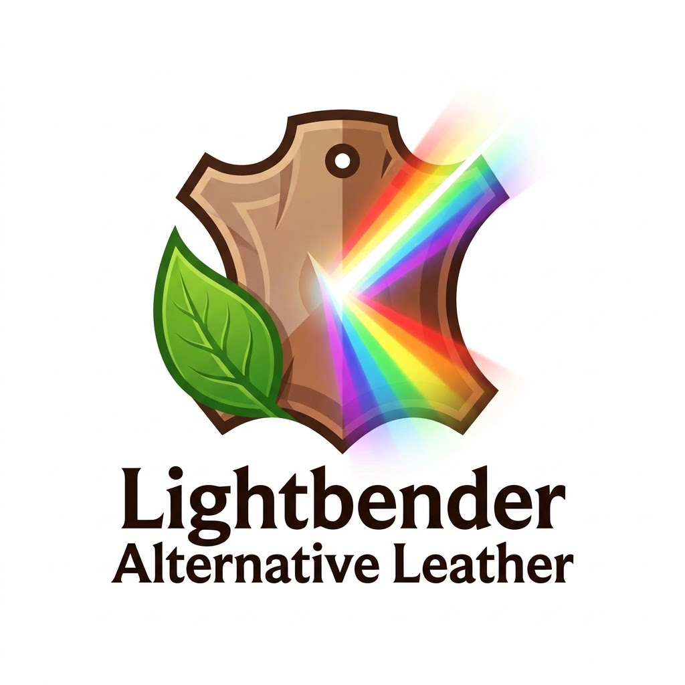

# Lightbender's "Alternative Leather for Hytale"

This is a compatibility fix and improved version of the original [Alternative Leather](https://www.curseforge.com/hytale/mods/alternative-leather) mod by [Aphidac](https://www.curseforge.com/members/aphidac). It ensures the mod works correctly with Hytale server version **0.7.1** and earlier alpha builds.

## Features
- **Animal Friendly:** Obtain leather items without needing to kill animals.
- **Log-to-Bark Mechanic:** Automatically utilizes any log (`Wood_Trunk`) in your inventory or nearby chests as a source of bark for crafting.
- **Clean Implementation:** Uses standard Hytale resource types for maximum compatibility with vanilla assets.

## Fixes included in this version:
1. **Manifest Compatibility:** Set `IncludesAssetPack: true` and updated `ServerVersion` targeting to `0.7.1`.
2. **Recipe Correction:** Reverted ingredient IDs to the standard CamelCase format (`Ingredient_Fibre`, `Ingredient_Tree_Sap`, `Ingredient_Tree_Bark`) to fix UI display issues and "Question Mark" icons.
3. **Resource Type optimization:** Replaced the non-functional `"Fruits"` resource tag with the universal **`Wood_Trunk`** tag, allowing the recipe to correctly pull from any log in the player's inventory.
4. **UI Labeling:** Fixed missing Item IDs that were causing `server.resource.type.name` errors in the crafting bench.

## Installation
1. Download or clone this repository.
2. Place the `Alternative Leather` folder (or a zip of its contents) into your Hytale server's `mods/` directory.
3. Restart your server.

## Original Credits
Original mod concept and assets by [Aphidac](https://www.curseforge.com/members/aphidac).
Original Mod Page: [Alternative Leather on CurseForge](https://www.curseforge.com/hytale/mods/alternative-leather)
